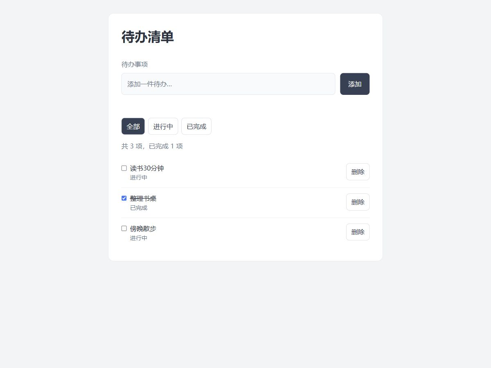

# 第5轮：最终代码审查与Git分支合并

## Prompt

Todo的增删、筛选和刷新恢复现在都能用了。请帮我最后核对一下三个更新函数，主要看有没有改旧数组或旧对象，以及保存失败时页面还能否更新。按课件要求在 feature/todo-complete 分支检查，确认通过后再合并 main；现有实现如果已经符合要求就保留。给出最终三个文件和必要的Git操作步骤，方便我对照检查。

## AI回答

核对后，添加仍用展开，删除用 filter，切换用 map 加对象展开；三个操作都是先更新 todos，再尝试保存，最后渲染。现有业务代码可以保留。本轮完整代码与此前最终版一致，另补充运行说明和审查记录，在功能分支提交后合并到 main。GitHub创建仓库和推送属于版本管理过程，单独记录即可。

## L1—L4审查

L1：三个文件的依赖和初始化顺序保持原样。L2：没有引入 var、push、splice 或直接修改 completed 的写法。L3：添加生成新数组，删除筛出新数组，切换只替换匹配任务对象，随后 save、render；筛选不覆盖完整 todos。L4：原有的纯文本输出、异常存储提示和焦点处理保留。本轮没有发现必须再改业务代码的问题。

## 四查清单

执行条件：脚本语法有效，页面所需元素检查仍在。输入边界：空白输入和异常存储沿用前面已验证的处理。状态变化：本轮又复核了增删改的旧引用、筛选和持久化。失败路径：保存失败的返回值与提示仍保留；远程推送是否成功必须另查，不能用本地提交代替。

## 判断和行动

选择保留当前实现，补齐README和本轮审查记录。在 feature/todo-complete 分支提交这些收尾资料，再合并 main；不把建仓库误记成新增了Todo页面功能。

## 验证方式

先对最终 app.js 做语法检查，再用Node中的简化DOM环境复核新数组、新任务对象、筛选、删除后的存储和清除后的恢复，共5项。另比较本轮三个代码文件与原最终版的字节内容，查看Git提交图和 main、功能分支的祖先关系。该逻辑复核不代替此前的真实浏览器页面测试。

## 验证与反思

5项逻辑复核全部通过，三个代码文件与原最终版完全一致。功能分支的提交和合并结果以Git提交记录为准；GitHub远程上传仍待本人完成身份认证后核对。

## 核心代码

```javascript
// addTodo
todos = [...todos, item];

// removeTodo
todos = todos.filter(todo => todo.id !== id);

// toggleTodo
todos = todos.map(todo => todo.id === id
    ? { ...todo, completed: !todo.completed }
    : todo);

// 三个操作更新数据后均继续执行
const saved = save();
render();
```

## Git操作

```shell
git switch feature/todo-complete
git add README.md round05.md docs/round05-effect.jpg
git commit -m "docs: final Todo review"
git switch main
git merge --no-ff feature/todo-complete -m "merge: final review"
```

## 本轮界面效果

第5轮最终代码的页面效果：3项待办、已完成1项。业务代码与原最终版一致，沿用该版本此前的真实运行截图；本轮重点为代码核对与Git分支合并。



## 补充审查与反思

本地分支已合并，不等于GitHub已有代码。当前自动环境在推送身份认证处受限，远程上传仍需本人运行上传脚本后确认。

Git分支管理的是代码版本，不是Todo页面上的一个按钮。代码验证后再合并，可以把“功能可用”和“版本已经整理好”分开检查。
